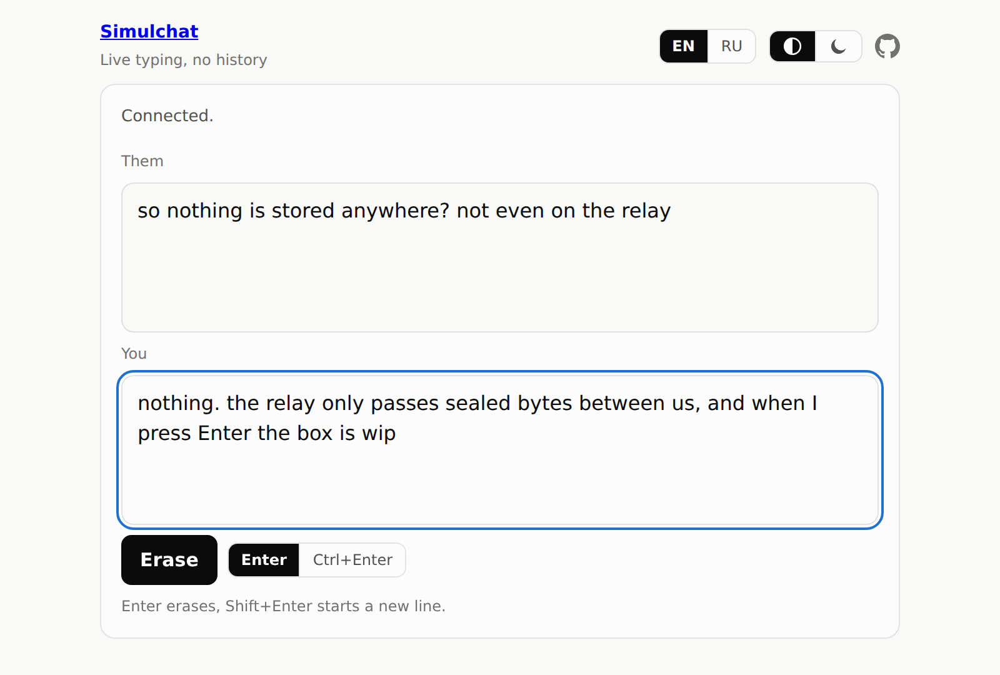

# Simulchat

[](https://vintagentleman.github.io/simulchat/)

> Two people, one link, live typing and no history.

A chat with no send button. Two people open the same link, and each sees the other's message box exactly as it is being typed, hesitations and corrections included. Enter sends nothing: it clears your own box for the next thought, and the other person watches it go. Nothing is stored anywhere, so it works more like a phone call than like messaging.

The idea goes back to Unix `talk(1)`. The end-to-end encrypted relay and the key carried in the link are borrowed from [unseen.fyi](https://github.com/meritt/unseen.fyi).

[](https://vintagentleman.github.io/simulchat/)

## Usage

- Press **Start a line** and send the link to one other person. A line holds two people at a time.
- Type. Enter clears your box and Shift+Enter starts a new line. If you would rather have Enter start new lines, switch the erase key to Ctrl+Enter.
- Closing the tab ends the conversation, not the line: the same link works again whenever you both open it.

## How it works

Starting a line draws 32 random bytes and puts them after the `#` in the link, a part of the URL that browsers never send to a server. From that secret, each browser derives a room id, which it uses to find the other person, and an AES-GCM key, which never leaves the browser. Every change to your box travels as one encrypted message holding the whole box, or only what changed.

The relay is a Cloudflare Worker with a Durable Object per room. It pairs the two connections and passes messages between them without being able to read them. It stores nothing, and once both people leave, the room ceases to exist.

The client is TypeScript, HTML and CSS built with Vite, with no framework and no runtime dependencies. The relay has no dependencies either.

## Privacy

- The relay cannot read what you type or learn the key. Cloudflare does see IP addresses, room ids, connection times, and the size and timing of every message. Typing rhythm is what the app shows, so it is visible by design.
- The link is the key. Anyone who has the link can join, and since the key never changes, anyone who records the traffic and later obtains the link can read it. There is no forward secrecy and no way to verify who is on the other end.
- The relay cannot forge or alter messages, but it could drop, delay or replay them.

## Availability

The relay runs on Cloudflare's free plan, so it may occasionally be unavailable. Where Cloudflare is blocked or throttled, the page still loads but the chat cannot connect.

## Development

Node 26 or later.

```bash
git clone https://github.com/vintagentleman/simulchat.git
cd simulchat
pnpm install
pnpm dev:relay    # the relay on :8787
pnpm dev          # the client on :5173
pnpm check        # the gate: typecheck, lint, format check, unit tests, build
pnpm test         # unit tests (Vitest)
pnpm test:e2e     # end-to-end tests (Playwright), against local relays
```

The end-to-end suite needs `pnpm exec playwright install chromium` once per machine. Commits follow [Conventional Commits](https://www.conventionalcommits.org), subject line only; enable the hook with `git config core.hooksPath .githooks`.

## License

[MIT](LICENSE) © 2026 Konstantin Sipunin.
